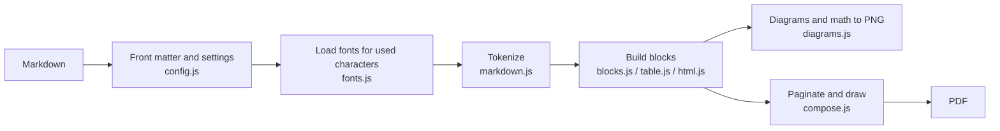

# Development

[README](../README.en.md) > Development

## Running locally

```bash
git clone https://github.com/Object-Works/md-to-pdf.git
cd md-to-pdf
npm install
npm link            # the md-to-pdf command now points at this directory
md-to-pdf --help
```

After `npm link`, changes in `src/` take effect in the `md-to-pdf` command immediately (no build step).

## Tests

```bash
npm test
```

Runs `test/*.test.js` with Node.js's built-in test runner (`node --test`). Tests that produce PDFs use chrome-headless-shell; install it with `npx puppeteer browsers install chrome-headless-shell` if needed.

## Directory structure

```
.
├── docs/
│   ├── README.md / README.en.md  Overview (Japanese / English)
│   ├── ja/                    Detailed docs (Japanese)
│   └── en/                    Detailed docs (English)
├── src/
│   ├── cli.js                 Command line (argument parsing, output paths, multiple files)
│   ├── index.js               Library entry point (mdToPdf, renderMarkdown)
│   ├── index.d.ts             Type definitions
│   ├── assets/fonts/          Bundled symbol and monospace fonts with their license
│   └── lib/
│       ├── md-to-pdf.js       Conversion pipeline (input → blocks → pages → PDF)
│       ├── config.js          Defaults, front matter, paper/margin/page-break settings
│       ├── markdown.js        markdown-it and plugins; inline styles, footnotes, alerts, task lists
│       ├── blocks.js          Turns Markdown into paragraph/heading/image/diagram/code blocks
│       ├── html.js            Reads HTML inside Markdown
│       ├── table.js           Table column widths and rows
│       ├── highlight.js       Code highlighting (highlight.js)
│       ├── text.js            Character widths and line wrapping (kinsoku)
│       ├── fonts.js           Font loading and replacement of undrawable characters
│       ├── diagrams.js        Renders Mermaid diagrams and math to PNG in headless Chrome
│       ├── compose.js         Pagination and drawing to PDF (links, italic, strikethrough, …)
│       └── render-html.js     Markdown to HTML (simple conversion for library use)
└── test/
```

## Conversion pipeline



1. **Settings** (`config.js`): merges front matter and options, and computes the text area from the paper size
2. **Fonts** (`fonts.js`): scans the characters in the document and loads and registers only the needed Noto Sans JP extra glyph files and Noto Emoji files
3. **Parsing** (`markdown.js`): tokenizes with markdown-it and plugins (footnotes, definition lists, highlight, sub/superscript, emoji, math)
4. **Blocks** (`blocks.js`): turns tokens into blocks (paragraphs, headings, code, table rows, images, diagrams, …), wraps text and measures heights. Mermaid and math are rendered to images here via `diagrams.js`
5. **Layout** (`compose.js`): keeps headings with their content, paginates according to the page-break settings, and draws with PDFKit

Layout calculations use CSS pixels (96 dpi); drawing to PDF uses points (72 dpi).

## Bundled fonts

MdSymbols and MdMono in `src/assets/fonts/` are subsets of DejaVu Sans / DejaVu Sans Mono, cut with fontTools (`pyftsubset`) to the symbols missing from Noto Sans JP and the characters used for code. Only subsets are bundled to keep the npm package small.

## Publishing

```bash
npm version patch   # bump the version in package.json
npm test
git push
npm publish --access public
```
