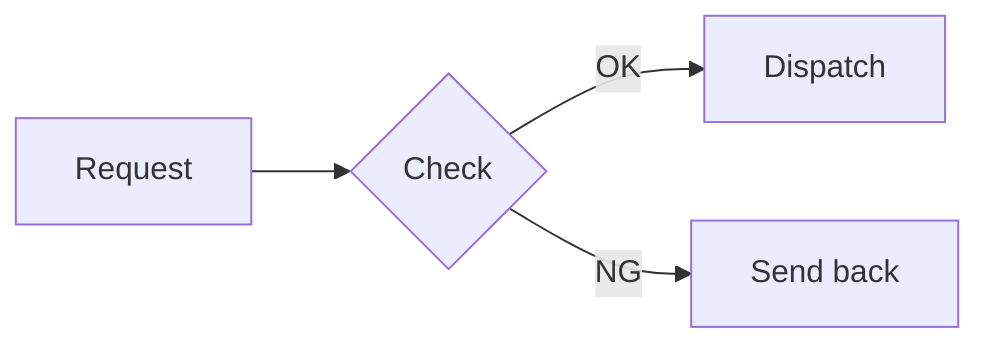

# Markdown syntax

[README](../README.en.md) > Markdown syntax

[CommonMark](https://commonmark.org/) and GitHub Flavored Markdown (GFM) are supported, plus several common extensions.

## Basics

| Syntax | In the PDF |
| --- | --- |
| `# Heading` … `###### Heading`, `===` / `---` underlines | Six heading levels. `#` and `##` get an underline |
| Blank line | Paragraph break |
| Two trailing spaces, trailing `\` | Line break |
| Plain newline | Joined with the previous line. Japanese lines are joined without a space, English lines with a space |
| `**bold**` `__bold__` | Bold |
| `*italic*` `_italic_` | Italic (glyphs are slanted, Japanese included) |
| `***bold italic***` | Bold italic |
| `` `code` `` | Monospace on a gray background |
| `> quote` | Gray box with a bar on the left. Can contain nested quotes, lists and code |
| `- item` `* item` `+ item` | Bullet list (•) |
| `1. item` | Ordered list. The start number (`5.`) is respected |
| `---` `***` `___` | Horizontal rule |
| Escapes like `\*`, entities like `&amp;` `&copy;` `&#x9AD9;` | Printed as the literal character |

Note that a blank line alone does not end a list (CommonMark rule). To restart numbering, put an HTML comment such as `<!-- -->` between the lists.

## Links and images

| Syntax | In the PDF |
| --- | --- |
| `[text](https://…)`, `<https://…>`, bare URLs | Blue text that opens in a browser when clicked |
| `[text][ref]` with `[ref]: https://…` | Reference-style link |
| `[to heading](#heading-text)` | Jumps to that heading in the document |
| `` | Image. Alone in a paragraph it gets its own line; inside text it is placed inline |
| `[](https://…)` | Clickable image |

- In-document `#…` anchors are generated from headings like GitHub does (lowercase letters, punctuation removed, spaces become `-`). For example `## 1. Heading` becomes `#1-heading`. A second heading with the same text gets `-1`
- Image paths are relative to the Markdown file. PNG and JPEG are supported
- Images that cannot be loaded (missing file, `http(s)://` URLs, SVG, …) are shown as `［画像: alt text］`
- Images wider than the text column are scaled down to fit

## Tables

```markdown
| Left | Center | Right |
| :--- | :---: | ---: |
| apple | banana | 1,234 |
```

- `:---` `:---:` `---:` alignment is applied
- Cells can contain bold, italic, code, links, images and `<br>` line breaks. Write a pipe as `\|`
- Column widths are chosen from the content and long cells wrap. Tables with many columns use a slightly smaller font
- Long tables break only between rows and repeat the header row on the next page

## Code

````markdown
```js
const greet = (name) => `Hello, ${name}`;
```
````

- With a language name, code is highlighted by [highlight.js](https://highlightjs.org/) (`js` `ts` `python` `bash` `json` `sql` `diff` `yaml` `html` …)
- Four-space indented code and `~~~` fences also work
- Long lines wrap. Tabs become four spaces
- Box-drawing characters (`├── │ └──`) are drawn in a monospace font, so they line up
- Code that fits on one page is never split. Only longer code is split per page

## GitHub extensions

| Syntax | In the PDF |
| --- | --- |
| `~~strikethrough~~` | Strikethrough |
| `- [x] done` `- [ ] todo` | ☑ / ☐ |
| `text[^1]` with `[^1]: footnote text` | Superscript number. Footnote texts are collected at the end of the document; click the number or ↩ to jump back and forth |
| `> [!NOTE]` `> [!TIP]` `> [!IMPORTANT]` `> [!WARNING]` `> [!CAUTION]` | Alert with a colored title (ⓘ Note, …) and a colored bar |
| `:smile:` `:rocket:` `:white_check_mark:` | Emoji (monochrome glyphs) |

As on GitHub, write `[!NOTE]` alone on the first line of the quote:

```markdown
> [!WARNING]
> This cannot be undone.
```

## Other extensions

| Syntax | In the PDF |
| --- | --- |
| `==highlight==` | Yellow highlight |
| `19^th^` | Superscript |
| `H~2~O` | Subscript |
| `Term` followed by a line `: definition` | Definition list (bold term, indented definition) |
| `$E = mc^2$` | Inline math |
| `$$ … $$` | Display math (centered) |

## Math

Math is rendered with [KaTeX](https://katex.org/) and embedded as an image. Any LaTeX command supported by KaTeX can be used.

```markdown
Inline math $E = mc^2$ and display math:

$$
\sum_{i=1}^{n} i = \frac{n(n+1)}{2}
$$
```

- Inline math is aligned to the baseline of the surrounding text
- A `$` followed or preceded by a space does not start/end math, so prices like `$5 and $10` stay text
- Invalid math is shown in KaTeX's red error style
- With `--no-mermaid`, math is printed as `$…$` text

## Mermaid

A fence with the language `mermaid` (or `mmd`) is rendered as a diagram.

````markdown

````

- Flowcharts, sequence diagrams, state diagrams, class diagrams, ER diagrams, Gantt charts, pie charts and other Mermaid 12 diagrams are supported
- The look matches previews such as Markdown Preview Enhanced (`default` theme). Line widths are adjusted so lines do not become too thin when a diagram is scaled down
- Japanese text in diagrams uses Noto Sans JP. `<br>` and `<b>` work
- Diagrams that do not fit are scaled down ([Command line](cli.md#large-diagrams)). A diagram right after a heading is scaled so it fits on the same page as the heading
- An invalid diagram is reported in red and kept as code; the rest of the document is still converted

```
⚠ Mermaid 図8 を描画できませんでした: Parse error on line 3: ...
```

## HTML

HTML written inside Markdown is converted too, focusing on patterns common in GitHub READMEs.

```markdown
<p align="center">
  
</p>
<p align="center">Caption with <b>bold</b>, a <a href="https://example.com">link</a><br>and a line break</p>

<div align="center">

**Markdown inside is centered too**

</div>
```

| HTML | In the PDF |
| --- | --- |
| `align="center"` `align="right"`, `style="text-align: center"`, `<center>` | Centered / right-aligned. Also applies to Markdown written inside `<div align="center">` |
| `` | Image. `width` and `height` (px or %) set the size. Works inline in text and in table cells |
| `<b>` `<strong>` `<i>` `<em>` `<code>` `<kbd>` `<a href>` `<br>` | Bold, italic, code, link, line break |
| `<s>` `<del>` `<u>` `<ins>` `<sub>` `<sup>` `<small>` `<mark>` | Strikethrough, underline, subscript, superscript, small text, highlight |
| `<h1>`–`<h6>` | Headings (also subject to `--page-break`) |
| `<p>` `<div>` `<ul>` `<ol>` `<li>` `<table>` `<blockquote>` `<pre>` `<hr>` | Paragraphs, lists, tables, quotes, code, rules |
| `<dl>` `<dt>` `<dd>` | Definition list (bold terms) |
| `<details>` `<summary>` | Printed expanded (a `▶ summary` line followed by the content) |
| `<input type="checkbox" checked>` | ☑ / ☐ |
| `<div style="height: 24px"></div>` | Vertical space of that height |
| `<!-- comments -->` `<script>` `<style>` `<svg>` `<iframe>` … | Not printed |

- Only `text-align`, `width` and `height` are read from CSS. Colors and fonts are ignored
- For ``, `width` alone keeps the aspect ratio; both set the exact size. `%` is relative to the text column width
