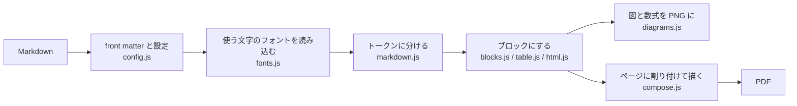

# 開発

[README](../README.md) > 開発

## 手元で動かす

```bash
git clone https://github.com/Object-Works/md-to-pdf.git
cd md-to-pdf
npm install
npm link            # md-to-pdf コマンドがこのディレクトリを指すようになる
md-to-pdf --help
```

`npm link` のあとは、`src/` を書き換えるとすぐ `md-to-pdf` コマンドに反映されます（ビルドは要りません）。

## テスト

```bash
npm test
```

Node.js 標準のテストランナー（`node --test`）で `test/*.test.js` を実行します。PDF を作るテストは chrome-headless-shell を使うので、入っていなければ `npx puppeteer browsers install chrome-headless-shell` で入れてください。

## ディレクトリ構成

```
.
├── docs/
│   ├── README.md / README.en.md  概要（日本語 / 英語）
│   ├── ja/                    詳しい説明（日本語）
│   └── en/                    詳しい説明（英語）
├── src/
│   ├── cli.js                 コマンドライン（引数の解釈、出力先の決定、複数ファイルの変換）
│   ├── index.js               ライブラリの入口（mdToPdf, renderMarkdown）
│   ├── index.d.ts             型定義
│   ├── assets/fonts/          同梱の記号フォント・等幅フォントとライセンス
│   └── lib/
│       ├── md-to-pdf.js       変換の流れ（入力 → ブロック → ページ → PDF）
│       ├── config.js          既定値、front matter、用紙・余白・改ページの設定
│       ├── markdown.js        markdown-it とプラグイン、インラインの装飾・脚注・アラート・タスクリスト
│       ├── blocks.js          Markdown を段落・見出し・画像・図・コードなどのブロックにする
│       ├── html.js            Markdown の中の HTML を読む
│       ├── table.js           表の列幅と行
│       ├── highlight.js       コードの色分け（highlight.js）
│       ├── text.js            文字の幅の計算と行の折り返し（禁則）
│       ├── fonts.js           フォントの読み込みと、描けない文字の置き換え
│       ├── diagrams.js        ヘッドレス Chrome で Mermaid の図と数式を PNG にする
│       ├── compose.js         ページ割りと PDF への描画（リンク、斜体、取り消し線など）
│       └── render-html.js     Markdown を HTML にする（ライブラリ用の簡易変換）
└── test/
```

## 変換の流れ



1. **設定**（`config.js`）: front matter とオプションをまとめ、用紙から本文の幅と高さを決めます
2. **フォント**（`fonts.js`）: 文書の文字を調べ、Noto Sans JP の追加グリフと Noto Emoji のうち必要なファイルだけを読み込んで PDF に登録します
3. **解析**（`markdown.js`）: markdown-it とプラグイン（脚注、定義リスト、マーカー、上付き・下付き、絵文字、数式）でトークンに分けます
4. **ブロック**（`blocks.js`）: トークンを段落・見出し・コード・表の行・画像・図などのブロックにし、文字を折り返して高さを測ります。Mermaid と数式はここで `diagrams.js` に頼んで画像にします
5. **組版**（`compose.js`）: 見出しと直後の内容をまとめ、改ページの指定に従ってページに割り付け、PDFKit で描きます

単位は、組版の計算は CSS と同じ px（96dpi）、PDF に描くときは pt（72dpi）です。

## 同梱フォントについて

`src/assets/fonts/` の MdSymbols と MdMono は、DejaVu Sans / DejaVu Sans Mono から、Noto Sans JP にない記号とコードに使う文字だけを fontTools（`pyftsubset`）で切り出したものです。npm パッケージを小さくするため、全体は同梱していません。

## 公開

```bash
npm version patch   # package.json のバージョンを上げる
npm test
git push
npm publish --access public
```
