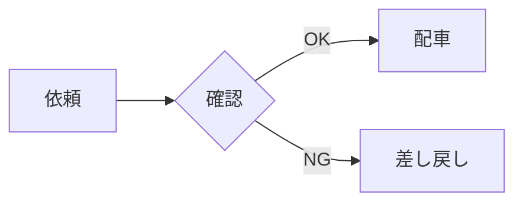

# Markdown の書き方

[README](../README.md) > Markdown の書き方

[CommonMark](https://commonmark.org/) と GitHub の書き方（GFM）に加え、よく使われる拡張に対応しています。

## 基本

| 書き方 | PDF での扱い |
| --- | --- |
| `# 見出し` 〜 `###### 見出し`、`===` / `---` の下線 | 6段階の見出し。`#` と `##` には下線が付きます |
| 空行 | 段落の区切り |
| 行末のスペース2つ、行末の `\` | 改行 |
| 改行だけ | 前の行とつなげる。日本語どうしは詰めて、英語はスペースを入れてつなぎます |
| `**太字**` `__太字__` | 太字 |
| `*斜体*` `_斜体_` | 斜体（字形を傾けて描きます。日本語も傾きます） |
| `***太字の斜体***` | 太字の斜体 |
| `` `コード` `` | 灰色の背景の等幅フォント |
| `> 引用` | 左に縦線の付いた灰色の囲み。入れ子、リスト、コードも入れられます |
| `- 項目` `* 項目` `+ 項目` | 箇条書き（•） |
| `1. 項目` | 番号付きリスト。開始番号（`5.`）も反映します |
| `---` `***` `___` | 区切り線 |
| `\*` などのエスケープ、`&amp;` `&copy;` `&#x9AD9;` | 記号として出します |

空行だけでは前のリストが終わらない点に注意してください（CommonMark の決まり）。番号を振り直したいときは、間に `<!-- -->` のような HTML コメントをはさみます。

## リンクと画像

| 書き方 | PDF での扱い |
| --- | --- |
| `[文字](https://…)`、`<https://…>`、URL をそのまま書く | 青い文字。クリックするとブラウザで開きます |
| `[文字][ref]` と `[ref]: https://…` | 参照形式のリンク |
| `[見出しへ](#見出しの文字)` | 文書内のその見出しへ移動します |
| `` | 画像。段落に画像だけなら1行を使って置き、文章の中なら行の中に置きます |
| `[](https://…)` | クリックできる画像 |

- 文書内リンクの `#…` は GitHub と同じ規則で見出しから作ります（英字は小文字、記号は削除、空白は `-`）。たとえば `## 1. 見出し` は `#1-見出し` です。同じ見出しが2つあれば、2つ目は `-1` が付きます
- 画像のパスは Markdown ファイルからの相対パスです。PNG と JPEG に対応しています
- 読み込めない画像（ファイルがない、`http(s)://` の画像、SVG など）は `［画像: 代替テキスト］` と表示します
- 本文の幅より大きい画像は、幅に合わせて縮小します

## 表

```markdown
| 左寄せ | 中央寄せ | 右寄せ |
| :--- | :---: | ---: |
| りんご | バナナ | 1,234 |
```

- `:---` `:---:` `---:` の寄せを反映します
- セルの中で太字・斜体・コード・リンク・画像・`<br>` の改行が使えます。`\|` でパイプ記号を書けます
- 列の幅は中身に合わせて自動で決め、長いセルは折り返します。列が多いときは文字を少し小さくします
- 長い表は行の間で改ページし、見出し行を次のページでも繰り返します

## コード

````markdown
```js
const greet = (name) => `こんにちは、${name}`;
```
````

- 言語名を書くと [highlight.js](https://highlightjs.org/) で色分けします（`js` `ts` `python` `bash` `json` `sql` `diff` `yaml` `html` など）
- 4スペースのインデントと `~~~` のフェンスも使えます
- 長い行は折り返します。タブは4文字分の空白にします
- 罫線（`├── │ └──`）は等幅フォントで描くので、縦にそろいます
- 1ページに収まるコードはページの途中で分割しません。収まらないものだけ、ページごとに分けます

## GitHub の拡張

| 書き方 | PDF での扱い |
| --- | --- |
| `~~取り消し~~` | 取り消し線 |
| `- [x] 完了` `- [ ] 未完了` | ☑ / ☐ |
| `本文[^1]` と `[^1]: 脚注の本文` | 上付きの番号。脚注の本文は文書の最後にまとめます。番号と ↩ をクリックすると行き来できます |
| `> [!NOTE]` `> [!TIP]` `> [!IMPORTANT]` `> [!WARNING]` `> [!CAUTION]` | 色付きの見出し（ⓘ Note など）と縦線の付いたアラート |
| `:smile:` `:rocket:` `:white_check_mark:` | 絵文字（白黒の字形） |

アラートは GitHub と同じく、`[!NOTE]` を引用の最初の行に単独で書きます。

```markdown
> [!WARNING]
> この操作は取り消せません。
```

## そのほかの拡張

| 書き方 | PDF での扱い |
| --- | --- |
| `==マーカー==` | 黄色のマーカー |
| `19^th^` | 上付き |
| `H~2~O` | 下付き |
| `用語` の次の行に `: 説明` | 定義リスト（用語は太字、説明は字下げ） |
| `$E = mc^2$` | 文中の数式 |
| `$$ … $$` | 独立した数式（中央そろえ） |

## 数式

[KaTeX](https://katex.org/) で描いた数式を画像として埋め込みます。KaTeX が対応している LaTeX の命令が使えます。

```markdown
文中の数式 $E = mc^2$ と、独立した数式:

$$
\sum_{i=1}^{n} i = \frac{n(n+1)}{2}
$$
```

- 文中の数式は、まわりの文字とベースラインをそろえて置きます
- `$` の直後と直前に空白があると数式になりません（`$5 と $10` のような金額は数式になりません）
- 書き間違えた数式は KaTeX のエラー表示（赤字）で出します
- `--no-mermaid` のときは、数式を `$…$` の文字のまま出します

## Mermaid

フェンスの言語名を `mermaid`（または `mmd`）にすると、図として描きます。

````markdown

````

- フローチャート、シーケンス図、状態遷移図、クラス図、ER 図、ガントチャート、円グラフなど、Mermaid 12 の図が使えます
- 見た目は Markdown Preview Enhanced などのプレビューと同じ（`default` テーマ）にしています。縮小しても線が細くなりすぎないよう、線の太さを調整します
- 図の中の日本語は Noto Sans JP で描きます。`<br>` や `<b>` も使えます
- ページに収まらない図は縮小します（[コマンドライン](cli.md#図が大きいとき)）。見出しの直後の図は、見出しと同じページに収まるように縮小します
- 書き間違えた図は、エラーの内容を赤字で出し、コードのまま残します。ほかの部分の変換は続けます

```
⚠ Mermaid 図8 を描画できませんでした: Parse error on line 3: ...
```

## HTML

Markdown の中に書いた HTML も PDF にします。GitHub の README でよく使う書き方を想定しています。

```markdown
<p align="center">
  
</p>
<p align="center">説明文。<b>太字</b>や<a href="https://example.com">リンク</a><br>改行も使えます</p>

<div align="center">

**中の Markdown も中央寄せになります**

</div>
```

| HTML | PDF での扱い |
| --- | --- |
| `align="center"` `align="right"`、`style="text-align: center"`、`<center>` | 中央寄せ・右寄せ。`<div align="center">` の中に書いた Markdown にも効きます |
| `` | 画像。`width` と `height`（px か %）で大きさを指定できます。文章や表のセルの中にも置けます |
| `<b>` `<strong>` `<i>` `<em>` `<code>` `<kbd>` `<a href>` `<br>` | 太字・斜体・コード・リンク・改行 |
| `<s>` `<del>` `<u>` `<ins>` `<sub>` `<sup>` `<small>` `<mark>` | 取り消し線・下線・下付き・上付き・小さい文字・マーカー |
| `<h1>`〜`<h6>` | 見出し（`--page-break` の対象にもなります） |
| `<p>` `<div>` `<ul>` `<ol>` `<li>` `<table>` `<blockquote>` `<pre>` `<hr>` | 段落・リスト・表・引用・コード・区切り線 |
| `<dl>` `<dt>` `<dd>` | 定義リスト（用語は太字） |
| `<details>` `<summary>` | 中身を開いた状態で出します（`▶ 要約` の行のあとに中身） |
| `<input type="checkbox" checked>` | ☑ / ☐ |
| `<div style="height: 24px"></div>` | 指定した高さの空白 |
| `<!-- コメント -->` `<script>` `<style>` `<svg>` `<iframe>` など | 出しません |

- CSS は `text-align`、`width`、`height` だけを読みます。色やフォントの指定は反映しません
- `` の大きさは、`width` だけなら縦横比を保ち、両方あればその大きさにします。`%` は本文の幅に対する割合です
